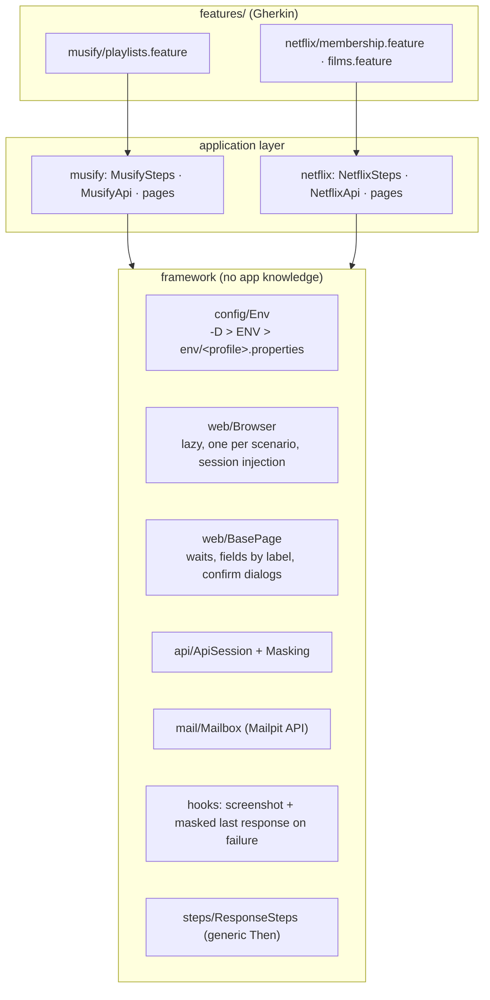

# Hybrid BDD Framework · UI + API + E-Mail in one scenario

[](https://github.com/Albatros46/Hybrid_BDD_Framework/actions/workflows/hybrid-tests.yml)
     

A Cucumber framework where **one scenario can use the browser, the REST API and the mailbox**, tested against **two real Spring Boot + React applications** that run in CI from their own repositories:

| Application | Stack | What is tested |
|---|---|---|
| [Musify](https://github.com/Albatros46/Spotify_Clone) (Spotify Clone) | Spring Boot 4, PostgreSQL 18, React 19 | playlists: privacy, ownership, order of songs |
| [Netflix Clone](https://github.com/Albatros46/Netflix_Clone) | Spring Boot 3.5, PostgreSQL 16, React 18, e-mail via SMTP | sign-up with e-mail verification, deactivation, films and "Meine Liste" |

Part of my 52-week QA Automation roadmap — **Week 20: Hybrid BDD Framework** (after [Cucumber, weeks 17–19](https://github.com/Albatros46/Cucumber)).

## The idea: each channel for what it is best at

```gherkin
Scenario: Sign-up in the browser, verification link from the e-mail, first login
  When "Nina" signs up on the Netflix sign-up page                          # browser
  Then "Nina" receives a verification e-mail with a link to the Netflix app  # Mailpit API
  When she opens the verification link in the browser                       # browser
  Then the page confirms "E-Mail-Adresse bestätigt! Sie können sich jetzt anmelden."
  When "Nina" logs in on the Netflix login page                             # browser
  Then the browser shows the film overview
```

```gherkin
Scenario: Removing a song in the browser renumbers the songs in the API
  Given "Anna" has a private playlist "Focus" with the songs:   # API: fast, exact setup
    | Blue Hour  |
    | Deep Work  |
    | Last Light |
  When "Anna" opens the playlist "Focus" in the browser          # browser: what the user does
  And she removes "Deep Work" from the playlist
  Then the API returns the playlist "Focus" to "Anna" with the songs:   # API: exact result
    | position | title      |
    | 1        | Blue Hour  |
    | 2        | Last Light |
```

| Step type | Usually through | Why |
|---|---|---|
| **Given** (arrange) | API | seconds instead of minutes of clicking; exact data |
| **When** (act) | browser | the behaviour the user really triggers |
| **Then** (assert) | API, page, e-mail | the place where the result matters |

## Architecture



PicoContainer creates every object **per scenario** and injects it by constructor, so 4 scenarios run in parallel without shared state (the lesson from [week 18](https://github.com/Albatros46/Cucumber)).

### What the framework does for every application

| Part | Does |
|---|---|
| `Env` | profiles `-Denv=local` / `-Denv=ci`; every value can be overridden by `-D` or an environment variable (`NETFLIX_ADMIN_PASSWORD`) — no secrets in CI files |
| `Browser` | **lazy**: started only when a step needs a page. Of 13 scenarios, 12 opened a browser; the API-only one never did — without any tag |
| `Browser.openWithSession` | the **login shortcut**: log in through the API, write the session into the app's `localStorage` (`musify.refreshToken`, `nc_token`), open the page directly. The login form is tested once, not in every scenario |
| `BasePage` | waits that tolerate React re-renders (`StaleElementReferenceException` ignored), fields found by their label, `window.confirm` handling |
| `ApiSession` + `Masking` | REST Assured per scenario; tokens and passwords are replaced by `***` before anything reaches a report |
| `Mailbox` | reads the e-mails from [Mailpit](https://mailpit.axllent.org/) (the SMTP catcher the app sends to), polls up to 15 s |
| `Unique` | e-mails, names and passwords with a random part per scenario: parallel and repeatable against the same database |
| `FrameworkHooks` | on a failed step: screenshot (if a browser was used) + last API response (masked) |

## Scenarios

| Feature | Scenarios | Channels |
|---|---|---|
| `musify/playlists` | API-prepared playlist shown correctly · public playlist created in the browser listed by the API · song removed in the browser → positions renumbered in the API · made public in the browser → another user can read it · deleted in the browser → 404 in the API · another user opens a private playlist by URL → "Playlist N not found" · wrong password on the login page | UI + API |
| `netflix/membership` | sign-up → e-mail → link → first login · login before verification refused, resend offered · verification link works only once · deactivated member cannot log in | UI + API + e-mail |
| `netflix/films` | film added to "Meine Liste" in the browser is in the API and on the list page · unpublished film disappears in the API (404) and in the browser search | UI + API + e-mail (setup) |

**13 scenarios green, two runs in a row; plus 2 `@known-bug` scenarios** (below).

## Defects found

| ID | Severity | Finding | Scenario |
|---|---|---|---|
| **NF-01** | High | A **deactivated** Netflix member can no longer log in (403), but the token she already has (valid 30 days) **keeps working**: profile and "Meine Liste" can still be used. The JWT filter builds the authentication from `loadUserByUsername` without checking `isEnabled()`. | `@known-bug` — expected 401, **actual 200** |
| **NF-02** | Low | An invalid id (`/api/users/abc/toggle-status`) answers **500** instead of 400, and the message exposes Java types (`java.lang.String … java.lang.Long`). | `@known-bug` — expected 400, **actual 500** |
| NF-03 | Cosmetic | The API message after verification reads *"You can **new** login."* The UI does not show it (it has its own German text), so only API clients see it. | — |

`@known-bug` scenarios describe the **correct** behaviour and are excluded from the default run (`not @known-bug` in the pom). CI runs them in an extra step and warns as soon as they pass — then the bug is fixed and the tag can go.

A hypothesis that turned out **wrong**: `removeIf(v -> v.getId() == videoId)` looked like a `Long == Long` reference comparison (broken above id 127). `Video.id` is a primitive `long`, so the value is unboxed and compared correctly — no finding without proof.

## Things I learned while building it (with evidence)

| Problem | Cause | Fix |
|---|---|---|
| A playlist page opened after the library page showed nothing | Musify **rotates** its refresh token. Writing the same (already used) token into `localStorage` a second time is a **replay**, which the API correctly rejects | `openWithSession` writes the session once per scenario, afterwards it only navigates |
| "Summer Hits" was found twice in the public list | an earlier run had left a playlist with the same name | the check matches name **and** owner id |
| `StaleElementReferenceException` when removing a song | React replaces the list while it is read | waits ignore stale elements; lists are read inside the wait |
| Expected English API messages, the page showed German ones | the UIs translate the API errors | UI steps check what the user reads, API steps what the API returns |
| `NoSuchMethodError: Location.getLine()` in every scenario | **`allure-cucumber7-jvm` (2.35.5 and 3.0.1) does not work with Cucumber 8** — the message model changed | Allure removed; Cucumber's own HTML report with screenshots and masked responses |

### Control runs

| Change | Result |
|---|---|
| expected 201 after a Netflix login (response contains a JWT) | step failed, report shows `{"token":"***", …}` |
| wrong text expected on the Musify login page | step failed, report has the PNG screenshot **and** the masked last response (`"accessToken":"***","refreshToken":"***"`) |
| search for `eyJ…` in `cucumber.json` and the HTML report | **0** |

## Run

Locally the two applications run from their own repositories:

```bash
# Musify: API on :8042 (./mvnw spring-boot:run), UI on :5173 (frontend: npx vite)
# Netflix Clone: docker compose up -d (PostgreSQL :5433 + Mailpit :8027), API on :8086, UI on :5175
mvn test                                           # 13 scenarios, 4 in parallel
mvn test -Dbrowser.headless=true
mvn test -Dcucumber.filter.tags="@netflix"         # one application
mvn test -Dcucumber.filter.tags="@hybrid"          # only scenarios that use UI and API
mvn test -Dcucumber.filter.tags="@known-bug"       # the open defects (red on purpose)
mvn test -Denv=ci                                  # the CI profile
```

The report: `target/cucumber-report.html`.

**CI** (`.github/workflows/hybrid-tests.yml`, every push and every night) checks out Musify at `v1.1.0` and Netflix Clone at a fixed commit, starts two PostgreSQL services and Mailpit, builds and starts both APIs with **secrets generated per run** (JWT secrets, Netflix admin password — masked), builds both UIs and serves them with `vite preview` (which proxies `/api`), waits until all five endpoints answer, runs the scenarios, then checks that the known bugs still reproduce.

## Structure

```
src/test/java/com/servet/hybrid/
├── framework/                 no knowledge of any application
│   ├── config/Env             profiles + overrides
│   ├── web/Browser · BasePage
│   ├── api/ApiSession · Masking
│   ├── mail/Mailbox           Mailpit REST API
│   ├── data/Unique            per-scenario unique data
│   ├── hooks/FrameworkHooks   evidence on failure, browser cleanup
│   └── steps/ResponseSteps    generic Then steps (status, error message in "message" or "error")
├── musify/                    MusifyApi · MusifyWorld · MusifySteps · pages/
└── netflix/                   NetflixApi · NetflixWorld · NetflixSteps · pages/
src/test/resources/
├── env/local.properties · ci.properties
├── junit-platform.properties
└── features/musify/ · features/netflix/
```

Adding a third application means a new package with its API class, pages and steps — the framework stays as it is.

## Next steps
- Run against a Selenium Grid (the `Browser` class is the only place to change)
- Fix NF-01 in the Netflix Clone (check `isEnabled()` in the JWT filter) and watch the `@known-bug` step turn the warning on
